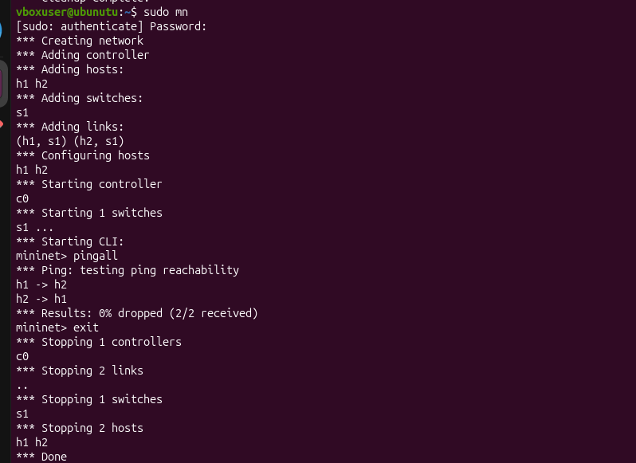
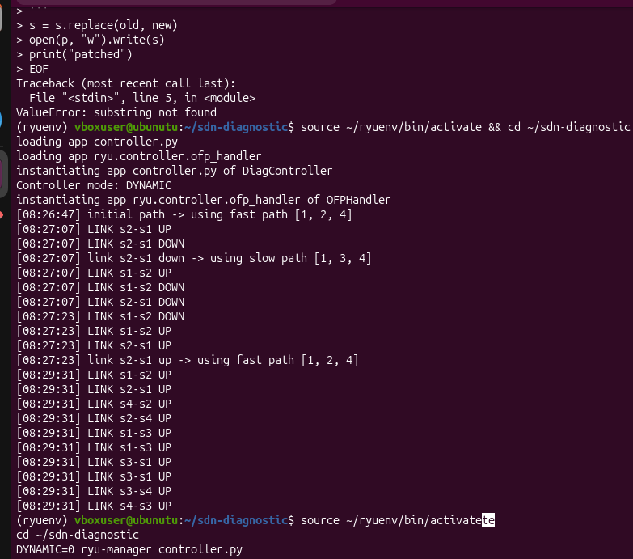
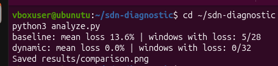

<name1:Achintya>, <name2:Arnavkothari>,<name3:ashithshetyy>
N Network Diagnostic & Path Analysis Tool

UDP socket probes (RTT, jitter, loss) running across a Mininet topology controlled by a
Ryu (OpenFlow 1.3) controller. The probe application reports to the controller, which
reroutes traffic on link failure or high loss. A static mode is the baseline.

## Architecture
```
h1 (probe client) -- s1 ==[ fast: s2 (5ms links) | slow: s3 (20ms links) ]== s4 -- h2 (UDP echo server)
                      \______ OpenFlow 1.3 ______ Ryu controller (controller.py) ______/
probe_monitor.py --(unix datagram socket /tmp/sdn_ctrl.sock: loss, RTT)--> controller
```
- Flows match `eth_dst` and are installed hop-by-hop along the chosen path (no STP, no flooding).
- Controller reroutes when (a) a switch port-status event shows a link down, or
  (b) a probe report shows loss >= 30%.
- Hosts share the root filesystem, so a unix socket is the simplest host -> controller channel.

## Files
| File | Purpose |
|---|---|
| `controller.py` | Ryu app: flow install, failure detection, rerouting, probe-report listener |
| `topo.py` | Mininet topology + automated failure experiment |
| `src/udp_server.py` | UDP echo server (h2) |
| `src/udp_client.py` | One-shot probe: RTT min/avg/max, loss, JSON output; `--report` sends to controller |
| `src/probe_monitor.py` | Continuous probing in 10-probe windows -> CSV + controller reports |
| `src/dashboard.py` | Flask dashboard of latest `udp_client.py` result |
| `analyze.py` | Baseline vs dynamic graph |
| `ryu/topology_monitor.py` | Optional discovery logger (not needed for the main demo) |

## Setup (Ubuntu 20.04/22.04)
```bash
sudo apt update
sudo apt install -y mininet openvswitch-switch python3-pip python3-matplotlib python3-flask git
sudo apt install -y python3-ryu || pip install eventlet==0.30.2 ryu
ryu-manager --version
sudo mn --test pingall && sudo mn -c
```

## Run: manual demo
Terminal 1: `ryu-manager controller.py`
Terminal 2: `sudo mn -c && sudo python3 topo.py`   (pingall should show 0% dropped)
```
mininet> h2 python3 src/udp_server.py &
mininet> h1 python3 src/udp_client.py --host 10.0.0.2 --count 20 --report
mininet> h1 python3 src/probe_monitor.py 10.0.0.2 40 results/manual.csv &
mininet> link s1 s2 down      # controller logs LINK DOWN and switches to slow path
mininet> link s1 s2 up
```
Restart Ryu every time Mininet is restarted.

## Run: experiments (baseline vs dynamic)
```bash
# Terminal 1                              # Terminal 2
DYNAMIC=0 ryu-manager controller.py       sudo mn -c && sudo python3 topo.py auto baseline
# (wait ~60 s, Ctrl+C Ryu)
DYNAMIC=1 ryu-manager controller.py       sudo mn -c && sudo python3 topo.py auto dynamic
python3 analyze.py                        # -> results/comparison.png
```
The link s1-s2 fails at ~12 s and is restored at ~27 s.

## Test cases
1. Normal: expect RTT ~20 ms (fast path), 0% loss.
2. Link failure, static: loss stays 100% until the link is restored.
3. Link failure, dynamic: brief loss, then RTT ~80 ms on slow path, 0% loss.
4. Lossy link (optional): `py net.links[2].intf1.config(loss=60)` while probing; probe loss triggers a reroute.

## Results
Fill in with your own numbers and `results/comparison.png`.

| Scenario | Mean loss | Worst window loss | Windows with loss | RTT before failure | RTT during failure (s1-s2 down) | RTT after restore |
|---|---|---|---|---|---|---|
| Static baseline | 13.6% | 100% | 5/28 | 26.2 ms | no reply (100% loss) | 23.8 ms |
| Dynamic (SDN reroute) | 0.0% | 0% | 0/32 | 24.2 ms | 86.7 ms | 25.7 ms |


**Analysis.** In the static baseline, failing link s1-s2 left h1 and h2 with no working path:
probe windows showed up to 100% loss until the link was restored (13.6% mean loss over the
run). In the dynamic run the Ryu controller received the port-status event, removed the old
flow rules and installed flows along the alternative path s1-s3-s4, so no probe window
recorded loss (0.0% mean loss). The cost was higher latency: average RTT rose from about
24 ms on the fast path to about 87 ms on the slow path, and returned to about 26 ms after
the link was restored and the controller switched back. The runs have different window
counts (28 vs 32) because timed-out probes make the baseline's windows last longer.

## Limitations
Two fixed candidate paths (not general shortest-path routing). Static ARP entries.
Link-failure detection depends on OpenFlow port-status events.
UDP timeouts show observed probe loss, not proof of a physical fault.

##screenshots
## Screenshotss








